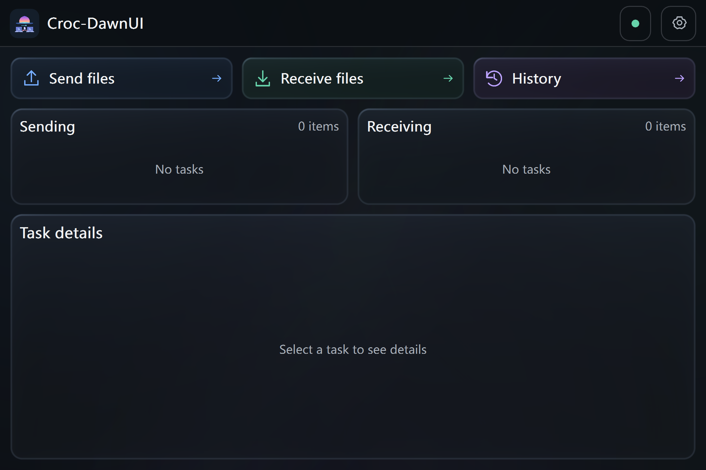

# Croc-DawnUI

[简体中文](README.md) · English

Croc-DawnUI is a desktop app for sending files and folders between two devices. Drop files into the window and share the transfer code. The recipient enters the code and chooses where to save the files. [Croc-lib](https://github.com/rayccr/Croc-lib) provides end-to-end encryption.

## Send your first file

1. **Sender** — Open **Send**, add files or folders, and start sending. Once the code is ready, copy it and share it with the recipient.
2. **Recipient** — Open **Receive**, enter the code, choose a destination, and start receiving. Confirm the files when prompted.
3. Follow the transfer on the home screen. Open **History** to see the result.

## Run from source

**Windows x64** — Place this repository and [Croc-lib](https://github.com/rayccr/Croc-lib) in the same parent directory. Build Croc-lib first. In Qt Creator, open this repository’s [CMakeLists.txt](CMakeLists.txt), select the Qt 6.10.1 MSVC 2022 x64 kit, and build and run the `Croc-DawnUI` target in Release mode.

**Ubuntu** — Follow the [Ubuntu build instructions](docs/UBUNTU.md) to build and launch the app.

## Project structure

| Directory | Contents |
| --- | --- |
| [src/ui/](src/ui/) | Pages, components, and icons |
| [src/logic/](src/logic/) | Transfer queues, settings, and file handling |
| [src/engine/](src/engine/) | Loads Croc-lib and reports transfer progress and results |

[MIT license](LICENSE) · [Third-party notices](THIRD_PARTY_NOTICES.md)
